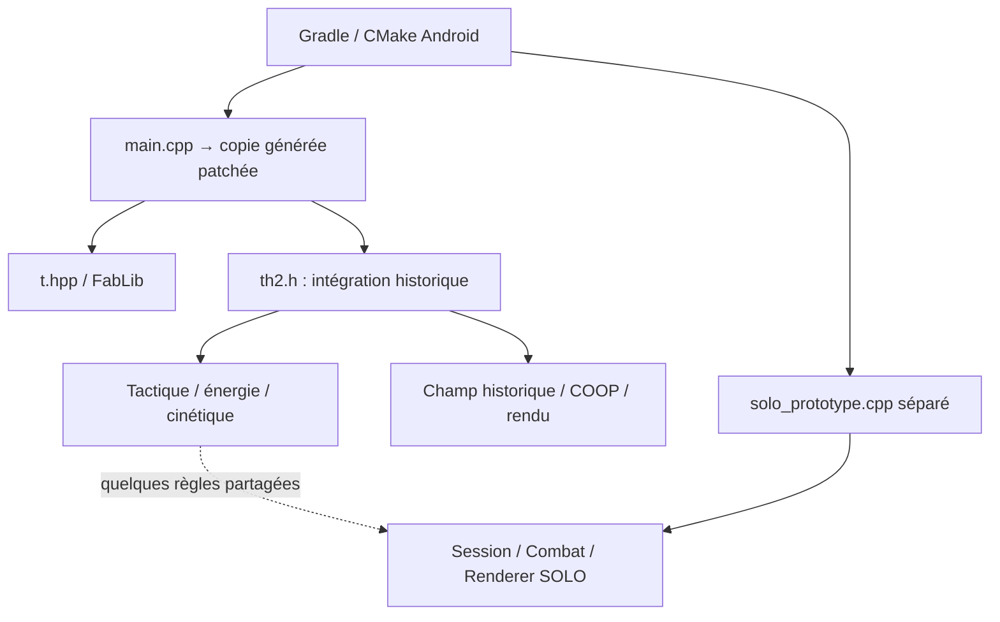

# SpaceFortress — audit de fondation COOP / SOLO

**Mission : ASTRA-COOP-SOLO-ARCH-001 — Fab, 11 octobre 2026.**

**Décision proposée : extraire progressivement le moteur COOP existant en composants communs, avec une façade de compatibilité pour ses appels historiques.** Le SOLO apporte le monde, les rencontres, la navigation et la progression. Le combat et son rendu viennent du même code que le COOP.

Cette proposition attend la validation de Fab. Aucun code de jeu, asset, script de compilation ou workflow n'a été modifié pour cet audit. Aucun test de jeu, build, APK, merge ou Release n'a été lancé. La branche documentaire contient uniquement cet audit, la mission reçue et les mises à jour des cinq mémoires.

## Référence et méthode

- Branche demandée : `feature/solo-worlds-tutorials-v1`.
- Snapshot audité : `1d8a48e245a8a019759c1a109a6e21d15e11b770`.
- Code applicatif correspondant : `7012a3b544e530fa0b87c2a9caa6a16f795ef1f8`. La comparaison GitHub jusqu'au snapshot ne montre ensuite que documentation, export d'APK et workflow d'export.
- Blob historique de `src/main.cpp` : `835059a0ecfe0f74708068b3259cad5db1cdb579`, vérifié.
- CI déjà existante, consultée : [run 38154338078](https://github.com/greenpower2669/SpaceFortressVs/actions/runs/38154338078), code `7012a3b5`, jobs SOLO core, SDL2 et Android réussis ; publication ignorée. Ce résultat antérieur ne valide ni cette proposition ni le rendu sur Samsung.
- Lecture du registre des missions puis des quatre mémoires ; inspection des sources, des tests, des scripts Android et des deux PNG. Aucun `AGENTS.md` trouvé dans l'arbre Git de la référence.
- Carte Djipie consultée sur la branche de secours `proposal/tiroirs-programmation-dialogue-v1`, après absence de `brainmap.md` sur `main`. Aucune modification de Djipie.

Les constats ci-dessous sont issus du code ou de l'inspection des PNG. Les recommandations sont explicitement des propositions. Les dernières captures Samsung citées par Fab n'ont pas été reproduites pendant cet audit.

## A. Diagnostic : pourquoi les greffes s'accumulent

### Deux simulations existent déjà

Le lanceur Android appelle `SpaceFortressMain`. Sans option, il appelle le `SDL_main` historique ; avec `--spacefortress-solo-prototype`, il appelle `runSoloPrototype`.

Le SOLO crée sa fenêtre, son renderer, son audio, un `CampaignController`, une `Session`, un `Combat` et un `KineticSurgeControl`. Sa boucle appelle `Session::step`/`soloNavigateFinger`, `Combat::step`, puis ses propres fonctions de dessin. Elle n'appelle ni `sfCoopTick`, ni `sfCoopProjectiles`, ni `sfCoopDrawArena`.

`solo_canonical_adapter.hpp` contient une interface de callbacks, mais aucun raccordement de production au moteur COOP. Son test utilise un `FakeShip`. De plus, cet adaptateur copie un état après déplacement puis constate des collisions : ce n'est pas encore une interface capable de résoudre les déplacements historiques contre les parois.

Sources : [entrée Android](https://github.com/greenpower2669/SpaceFortressVs/blob/1d8a48e245a8a019759c1a109a6e21d15e11b770/android/app/src/main/cpp/sdl_entry.cpp), [boucle SOLO](https://github.com/greenpower2669/SpaceFortressVs/blob/1d8a48e245a8a019759c1a109a6e21d15e11b770/src/solo_prototype.cpp#L25), [adaptateur](https://github.com/greenpower2669/SpaceFortressVs/blob/1d8a48e245a8a019759c1a109a6e21d15e11b770/src/solo_canonical_adapter.hpp), [test avec doublure](https://github.com/greenpower2669/SpaceFortressVs/blob/1d8a48e245a8a019759c1a109a6e21d15e11b770/tests/solo_canonical_adapter_regressions.cpp).

### La réutilisation actuelle est réelle, mais partielle

| Élément | COOP effectivement exécuté | SOLO actuel | Conséquence |
|---|---|---|---|
| Vaisseau | `remaster/player_blue.png`, respiration `sprite::vib`, rotation au rendu | `sb.png`, dessin propre au SOLO | Charger une image historique ne reproduit pas le rendu COOP |
| Dimensions | Corps nominal : 15 % du petit côté | Diamètre nominal : environ 10 % de la largeur, hors minimum de pixels | L'échelle visuelle n'est pas identique |
| Orbe bleue | `orbebb.png` via `IMG_PATHtj1` | `orbeb.png` | Variante différente |
| Missile | Interception prédictive du boss mobile, virage angulaire borné | Poursuite du point de visée mémorisé, correction des composantes de vitesse | Deux lois de guidage |
| Tir | `sfCoopFire`, dispersion réelle hors missile, origine à la bouche | `Combat::fire`, direction exacte vers le doigt, origine au centre | La règle de dispersion partagée n'est pas appelée en SOLO |
| Énergie | `sprite::nrj`, 0 plein / 50 épuisé | `Session::heatSpent`, mêmes fonctions pures pour plusieurs règles | Équations partagées, cycle de combat distinct |
| Boss | Catalogue, phases, attaques, menace, charge, esquive | `Tile::Boss`, 100 PV locaux ; ennemi simple supprimé au premier impact | Pas d'IA historique raccordée |
| Astéroïdes | Objets `sprite`, dimensions, vitesses, impacts, fragmentation | Cases de carte, intégrité 0..1 | La masse et la dynamique ne sont pas les mêmes |
| Cinétique | Résolution physique, état de charge, minage, poussières, effets | État partagé, mais érosion de cases et purge reprogrammées | Les fonctions complètes du champ ne sont pas réutilisées |
| Poussières | `parts`, collecte pondérée, rouge réactif, soin du boss | `SoloDust`, huit directions, collecte simplifiée | Deux économies et deux cycles d'effets |

Sources : [combat COOP](https://github.com/greenpower2669/SpaceFortressVs/blob/1d8a48e245a8a019759c1a109a6e21d15e11b770/src/campaign_runtime.hpp#L553), [textures COOP](https://github.com/greenpower2669/SpaceFortressVs/blob/1d8a48e245a8a019759c1a109a6e21d15e11b770/src/campaign_runtime.hpp#L1146), [rendu COOP](https://github.com/greenpower2669/SpaceFortressVs/blob/1d8a48e245a8a019759c1a109a6e21d15e11b770/src/campaign_runtime.hpp#L1506), [combat SOLO](https://github.com/greenpower2669/SpaceFortressVs/blob/1d8a48e245a8a019759c1a109a6e21d15e11b770/src/solo_combat.hpp), [rendu SOLO](https://github.com/greenpower2669/SpaceFortressVs/blob/1d8a48e245a8a019759c1a109a6e21d15e11b770/src/solo_renderer.hpp#L136), [champ historique](https://github.com/greenpower2669/SpaceFortressVs/blob/1d8a48e245a8a019759c1a109a6e21d15e11b770/src/legacy_field_runtime.hpp).

Un exemple mesurable du problème d'unités : le SOLO transmet `map.width` à la formule de vitesse du tir. La carte normale fait 54 colonnes, la vue en montre 6. Après projection, cette base vaut donc neuf largeurs d'écran, alors que le COOP emploie une largeur d'arène. C'est un rapport déduit des formules, pas une mesure réalisée sur téléphone.

Le partage de quelques équations ne peut donc pas garantir la parité du comportement complet. Continuer à ajouter des équivalents SOLO entretient précisément les deux moteurs que Fab veut éviter.

### Le véritable socle est plus large que `campaign_runtime.hpp`

`th2.h` introduit également les couches UI, remaster, cycle de vie, Hall et aide. Le COOP fonctionne dans l'unité de compilation historique, sur des joueurs et listes globaux. La préparation Android retire certains blocs de `main.cpp`, branche le champ commun, ajoute des gardes de synchronisation et insère le dispatch COOP. Copier uniquement le fichier campagne ne copie donc pas un moteur autonome.

Sources : [CMake](https://github.com/greenpower2669/SpaceFortressVs/blob/1d8a48e245a8a019759c1a109a6e21d15e11b770/android/app/src/main/cpp/CMakeLists.txt), [génération](https://github.com/greenpower2669/SpaceFortressVs/blob/1d8a48e245a8a019759c1a109a6e21d15e11b770/scripts/prepare-legacy-source.cmake), [ordre d'inclusion](https://github.com/greenpower2669/SpaceFortressVs/blob/1d8a48e245a8a019759c1a109a6e21d15e11b770/src/th2.h).

## B. Architecture recommandée

| Option | Intérêt | Risque | Avis |
|---|---|---|---|
| Copie complète du COOP pour le SOLO | Départ visuel potentiellement rapide | Double code, états globaux, correctifs à reporter indéfiniment | Écartée comme architecture durable |
| Extraction progressive vers un code commun | Comportements réutilisés, comparaison possible à chaque étape | Travail nécessaire sur les dépendances et les états | **Recommandée** |
| Envelopper le COOP tel quel et déplacer ses objets pour scroller | Apparence de petit chantier | Mélange écran/monde, limites d'arène, états et sauvegardes cachés | Écartée |

Il ne faut pas entreprendre une conversion globale en ECS ni réécrire toutes les classes. Extraire un bloc existant à la fois, conserver les noms historiques comme façades et les faire appeler la même implémentation que le SOLO. Une copie figée du commit peut servir de témoin de comparaison ; elle ne devient pas un second moteur maintenu.

### Répartition cible — noms indicatifs, aucun de ces modules n'est annoncé comme livré

| Responsabilité | Contenu et origine |
|---|---|
| Contexte de combat | Joueurs, projectiles, boss actifs, astéroïdes, poussières, énergie, charges, horloges ; issus des états historiques |
| Fonctions communes | Tir, guidage, dégâts, minage, collecte, cinétique, attaques de boss ; corps historiques déplacés et paramétrés |
| Monde SOLO | Carte, géométrie des parois, zones de danger, positions de ressources et de rencontres |
| Directeur de rencontres | Activation des ennemis, lien entre boss vaincu/relais/sortie ; aucun calcul de combat concurrent |
| Présentation commune | Dessin historique des acteurs et effets avec une transformation de vue explicite |
| Façade COOP | Arène, deux pilotes, contrôles et sauvegarde campagne existants, caméra identité |
| Façade SOLO | Un pilote, visée 360°, carte exploratoire, caméra circulaire et progression SOLO |

La règle déterminante : **un seul propriétaire de la position, des PV et de `nrj` du joueur**. Le monde demande une résolution de déplacement ; il ne maintient pas une seconde copie vivante du vaisseau. Le renderer lit cet état et ne le modifie jamais.

### Réutilisation directe et adaptations nécessaires

| Bloc historique | À conserver | Frontière à adapter |
|---|---|---|
| Énergie et protection | Fonctions de `ship_energy_rules.hpp`, cycle `nrj`, coûts et dégâts | Joueur/contexte explicite ; supprimer la conversion en PV SOLO concurrents |
| `sfCoopFire` / `sfCoopProjectiles` | Cadence, dispersion, vitesse, guidage prédictif, dégâts et effets | Direction de tir, cible identifiée dans le monde, obstacles et durée de vie indépendants du viewport |
| `sfKineticSurgeConeContains` et minage historique | Ouverture, portée, seuils, fatigue et collecte | Base de visée explicite au lieu du signe vertical déduit du numéro de joueur |
| `sfCoopPattern` et déplacement de boss | Patterns, phases, menace, esquive et paramètres de profil | Origine/région de rencontre, cibles actives, résolution des contacts avec terrain |
| Champ historique | Astéroïdes, fragmentation, poussières, impacts et explosions | Points d'apparition valides, frontières physiques et état du champ par session |
| `sfCoopDrawArena` et audio | Assets, animation, couches d'effets et événements sonores | Projection monde ; HUD séparé ; dépendances de renderer/session explicites |

Pour le cône, fournir une direction unitaire `d` et son perpendiculaire. Pour un point relatif `r`, remplacer le « devant » vertical par `dot(r,d)` et l'écart latéral par `dot(r,perp(d))`. Réutiliser ensuite les mêmes tests de portée, largeur et padding. Dans la façade COOP, `d=(0,+1)` ou `(0,-1)` restitue les directions historiques. Dans le SOLO, `d` vient du vaisseau vers la visée du second doigt ; conserver la dernière direction valide si le vecteur est nul. Le point d'origine du cône/minage doit tourner avec cette base, pas rester au nez vertical historique.

L'adaptation des boss aux murs est la modification de comportement la plus sensible : contraindre leur mouvement et leurs lignes de tir change certaines attaques, même en conservant leurs calculs. Les premières salles doivent être dimensionnées pour accueillir leurs trajectoires historiques ; mesurer les blocages avant d'envisager une navigation d'obstacles plus complexe.

### Boss et miniboss

Le code contient 50 profils, dix familles de patterns, cinq tiers et quatre variantes de campagne, soit 200 rencontres. Il contient séparément neuf niveaux de Danger. Ces deux axes ne doivent pas être fusionnés. Les neuf Dangers influencent notamment dégâts hostiles, cône et certains comportements ; le profil de campagne conserve ses propres caractéristiques.

Réutiliser `sfCoopPattern`, menace, esquive missile, phases et guidage ; leur fournir un état de boss, une liste de cibles actives et une région de combat. Remplacer les limites autour de l'origine de l'écran par les limites de cette région **sans déplacer les entités à chaque mouvement de caméra**. Le mouvement proposé du boss passe ensuite par les collisions du monde.

Je n'ai pas identifié de catalogue distinct de miniboss dans les fichiers audités. Les rencontres intermédiaires peuvent employer des profils existants, choisis explicitement dans les données du niveau. Aucun nerf automatique des PV ou nouvelle IA simplifiée ne doit être introduit sous couvert d'adaptation.

Pour commencer : rencontres successives, un boss actif à la fois, mais état attaché à un identifiant de rencontre. L'exploration continue sans boss actif. Ce point doit être extrait : aujourd'hui `sfCoopTick` conditionne tout au combat et suppose toujours un boss. Supprimer le boss en mettant ses PV à zéro déclencherait la victoire.

La mort d'un boss doit produire un événement destiné au directeur de rencontres. Ne pas appeler directement `sfCoopWin` depuis le SOLO : cette fonction écrit la sauvegarde campagne historique et bascule vers l'écran de noms. Les états rencontrés/vaincus restent mémorisés pendant les retours en arrière. Le mapping exact niveaux SOLO → profils boss reste à spécifier avant le lot de rencontres, sans le deviner.

Sources : [catalogue](https://github.com/greenpower2669/SpaceFortressVs/blob/1d8a48e245a8a019759c1a109a6e21d15e11b770/src/boss_catalog.hpp), [Danger](https://github.com/greenpower2669/SpaceFortressVs/blob/1d8a48e245a8a019759c1a109a6e21d15e11b770/src/boss_danger.hpp), [simulation et démarrage](https://github.com/greenpower2669/SpaceFortressVs/blob/1d8a48e245a8a019759c1a109a6e21d15e11b770/src/campaign_runtime.hpp#L944).

## C. Migration du travail SOLO et des parois

| Partie actuelle | Décision proposée |
|---|---|
| `solo_map_generator.hpp`, modèle de carte, identifiants et graines | Conserver le contenu et la connectivité ; séparer terrain et marqueurs d'apparition d'entités |
| Relais, sortie, exploration, minimap | Conserver ; lire la position du joueur commun et les événements de rencontres |
| `solo_progression*`, sélection et `solo_campaign_persistence.hpp` | Conserver le format `SFSOLO1` et la sauvegarde avant validation de victoire |
| `solo_campaign_controller.hpp` | Conserver l'orchestration ; remplacer sa possession du pilote/combat provisoires par une session commune |
| Loi circulaire, deux doigts et visée | Conserver les exigences ; adapter les unités et faire résoudre le déplacement par le moteur commun |
| `Session::step` | Répartir objectifs/dangers d'un côté, physique commune de l'autre ; ne plus intégrer un second pilote |
| `solo_combat.hpp` | Retirer du chemin de production après preuve de parité ; conserver provisoirement comme ancien prototype de référence |
| `solo_canonical_adapter.hpp` | Remplacer son contrat insuffisant ; ne pas empiler des callbacks sur une copie d'état après mouvement |
| `solo_kinetic_control.hpp` | Conserver l'intention de visée ; retirer l'érosion/purge de cases au profit des astéroïdes historiques |
| `solo_renderer.hpp`, `solo_audio.hpp` | Conserver HUD, minimap et décor SOLO ; remplacer les dessins/séquences de combat par la présentation historique |

La sauvegarde actuelle contient les niveaux terminés : six masques de vingt niveaux. Elle ne sérialise ni une partie en cours, ni le brouillard, ni les astéroïdes détruits, ni les PV de boss. Préserver cette compatibilité ne signifie pas prétendre qu'une reprise complète existe déjà. Une telle reprise, si souhaitée, sera un format versionné distinct, sans écraser `SFSOLO1`.

### Les murs nécessitent une préparation graphique réelle

Fichiers inspectés : `ParoisModeSolo.png` (1536 × 1024, RGBA) et `EnvironnementsModeSolo.png` (1122 × 1402, RGBA). Le second est le nom utilisé dans la branche pour la planche d'environnements mentionnée par Fab ; son identité avec l'original nommé dans la mission n'a pas été revérifiée sur `main`.

Constats vérifiables :

1. La planche de parois contient titres, encadrements, exemples et éléments de proportions différentes ; les panneaux thématiques ne sont pas six colonnes égales. `soloWallArtBox` suppose pourtant un décalage `theme * 256`.
2. Les découpes, parfois très allongées, sont toutes redimensionnées en 128 × 128. Cela déforme leur silhouette avant même l'affichage.
3. T et croix utilisent le même « rocher de jonction ». Une image de rocher isolé ne garantit pas les connexions d'un réseau plein.
4. Le renderer applique un miroir horizontal lorsque `variant == 2`, y compris aux coins dont la rotation vient d'être déterminée. Le miroir peut changer leur connectivité sans changer le masque de voisinage.
5. Les bords sont rendus transparents puis les cellules se chevauchent de quelques pixels. Cela ne garantit pas une jonction opaque continue aux différents zooms.
6. Les tests de l'atlas contrôlent bornes et valeurs attendues ; ils ne chargent pas les textures pour prouver les jonctions. Ils valident même l'hypothèse des bandes de 256 pixels.

Ces mécanismes expliquent des risques précis de découpe/orientation ; l'attribution de chaque défaut de la dernière capture Samsung reste à confirmer par reproduction.

Préparation proposée : un manifeste donnant les vrais rectangles, pivots et connexions de chaque pièce ; proportions conservées ; détourage alpha contrôlé ; textures de remplissage raccordables, bords, angles concaves/convexes et variantes compatibles. Restreindre rotations/miroirs aux transformations qui respectent ces connexions. Les FX énergétiques et fumées restent des décorations séparées.

Pour les masses rocheuses du labyrinthe, rendre un remplissage continu et son contour exposé, avec détails déterministes en coordonnées monde. Le masque à quatre voisins peut aider, mais ne décrit pas à lui seul tous les coins concaves des masses épaisses. Les astéroïdes historiques fournissent des détails visuels utiles ; ils ne constituent pas automatiquement un kit de murs raccordables.

Collisions et visibilité restent séparées. Actuellement Lava et Beam sont dessinés comme des murs, mais seuls les `Tile::Rock` bloquent le pilote. Le nouveau rendu doit distinguer clairement terrain solide et zone traversable dangereuse, en préservant la règle décidée pour chaque matériau.

Sources : [sélection et rectangles](https://github.com/greenpower2669/SpaceFortressVs/blob/1d8a48e245a8a019759c1a109a6e21d15e11b770/src/solo_scenery.hpp), [extraction](https://github.com/greenpower2669/SpaceFortressVs/blob/1d8a48e245a8a019759c1a109a6e21d15e11b770/src/solo_renderer.hpp#L62), [miroir au rendu](https://github.com/greenpower2669/SpaceFortressVs/blob/1d8a48e245a8a019759c1a109a6e21d15e11b770/src/solo_renderer.hpp#L280), [tests actuels](https://github.com/greenpower2669/SpaceFortressVs/blob/1d8a48e245a8a019759c1a109a6e21d15e11b770/tests/solo_atlas_regressions.cpp), [sauvegarde](https://github.com/greenpower2669/SpaceFortressVs/blob/1d8a48e245a8a019759c1a109a6e21d15e11b770/src/solo_progression.hpp).

## D. États, ressources et isolation

### Ce qui déborde aujourd'hui du seul état COOP

`SfCoopState` possède beaucoup de données, mais pas les vaisseaux ni tout le champ. `Spritej1/2`, `sa1`, `particules`, `particulesr`, `explos` et les listes de tirs classiques sont définis dans `main.cpp`. `sfObserved`, tourelles, horloges, sons et états cinétiques sont ailleurs. `sfBossDangerIndex` est global. Plusieurs fonctions et variables `static` de headers vivent dans leur unité de compilation ; les variables `inline` sont, elles, partagées dans le programme.

La séparation Android `android:process=":solo"` isole actuellement les deux activités par processus. Elle protège utilement le diagnostic, mais ne remplace pas un contexte de jeu maîtrisé pour une intégration ultérieure. Dans un même processus, inclure le header cinétique ne crée pas une copie indépendante de ses variables `inline`.

### Ownership proposé

| Données | Propriétaire | Règle |
|---|---|---|
| PV, `nrj`, position/vitesse, historique du vaisseau | Contexte de combat | Une seule version ; conserver 1000 PV internes, pourcentage seulement dans l'UI |
| Boss, menace, cooldowns, tirs, champs | Contexte / état de rencontre | Identifiants stables, aucune cible implicite au centre de l'écran |
| Astéroïdes et poussières collectables | Champ du contexte | Objets persistants, destruction et collecte une seule fois |
| Charge, ondes, flashes, horloges et aléatoire | Contexte | Reset explicite ; horloge injectée pour les comparaisons ; rendu sans consommation du hasard gameplay |
| Carte, relais, exploration | État SOLO | Reçoit les événements ; aucune copie concurrente des PV/positions |
| Textures | Cache de présentation lié au renderer | Destruction/invalidation lors de sa recréation, recréation depuis les mêmes assets |
| Sons et canaux | Service audio de la session | Arrêter uniquement les canaux possédés ; aucun second mixer autonome |
| Touches | Routeur du mode | Identifiants de doigts, annulation lors d'une pause/sortie, visée distincte du pilotage |
| Sauvegardes | Contrôleur du mode | SOLO → sauvegarde SOLO ; campagne historique → sauvegarde historique |

Éviter de copier/sauvegarder/restaurer des dizaines de variables globales à chaque frame pour simuler plusieurs contextes. Extraire leurs dépendances explicitement, par blocs. Les anciens appels conservent une façade vers le contexte historique ; le SOLO appelle les mêmes fonctions avec son contexte. Une vue de références vers les objets historiques peut aider la transition, sans créer de copies ni déplacer immédiatement toutes les allocations.

Conserver initialement les types `sprite`, `parts` et leurs containers là où cela réduit le risque. Leur cycle de destruction doit être explicite avant de convertir éventuellement les pointeurs propriétaires. Ne pas cumuler ce chantier avec un changement global d'allocateur ou de moteur de rendu.

Un masque de pilotes actifs est nécessaire. Le SOLO a un seul pilote ; mettre simplement l'autre à zéro PV activerait les chemins de réanimation, les messages de secours et certains calculs de défaite. Tous les accès aux deux joueurs, cibles, collecteurs, tourelles et scores doivent respecter ce masque. Les tourelles d'arène demandent une politique spatiale explicite, pas un ancrage aux bords de la caméra.

### Ordonnancement et cycle Android

Le COOP subdivise un frame en `ceil(dt * 90)` pas ; le champ historique accumule séparément des pas de 1/60 s. Les vitesses de certaines classes historiques restent exprimées par pas avec `k0`, alors que les tirs tactiques sont en unités/seconde. Préserver ces frontières et leur ordre lors de la première extraction. Une normalisation complète du temps serait un changement distinct, après preuve de parité.

Le code Android généré empêche déjà certains threads auxiliaires d'avancer le COOP. La nouvelle intégration doit posséder une seule boucle qui avance son contexte, et conserver les gardes existantes de la façade historique. Pas de lancement simultané de `SDL_main` et de la boucle SOLO sur les mêmes objets.

Sur pause, perte de focus et retour accueil : arrêter l'avancement de la session, annuler les doigts/charges selon le comportement convenu, invalider les échantillons de vitesse, puis recréer les textures si nécessaire. Sur reprise, aucun rattrapage de plusieurs secondes de physique en une fois. Garder l'activité `:solo` durant les premiers APK comparatifs ; la suppression de cette isolation sera un lot de cycle de vie à part entière.

Sources : [globaux historiques](https://github.com/greenpower2669/SpaceFortressVs/blob/1d8a48e245a8a019759c1a109a6e21d15e11b770/src/main.cpp#L73), [état COOP](https://github.com/greenpower2669/SpaceFortressVs/blob/1d8a48e245a8a019759c1a109a6e21d15e11b770/src/campaign_runtime.hpp#L16), [état cinétique](https://github.com/greenpower2669/SpaceFortressVs/blob/1d8a48e245a8a019759c1a109a6e21d15e11b770/src/kinetic_shield.hpp#L63), [pas du champ](https://github.com/greenpower2669/SpaceFortressVs/blob/1d8a48e245a8a019759c1a109a6e21d15e11b770/src/legacy_field_runtime.hpp#L482), [manifest debug](https://github.com/greenpower2669/SpaceFortressVs/blob/1d8a48e245a8a019759c1a109a6e21d15e11b770/android/app/src/debug/AndroidManifest.xml).

## E. Monde, caméra, coordonnées et collisions

### Séparer quatre grandeurs aujourd'hui confondues

1. **Échelle de référence du combat** : les dimensions utilisées par les formules historiques de vitesses, tailles et masses. Elles restent stables pendant la session SOLO.
2. **Étendue du monde** : la carte complète, sans influence sur la puissance des armes.
3. **Région de rencontre** : origine et frontières d'une salle où se déplace un boss.
4. **Vue** : viewport, position de caméra et pixels par unité ; uniquement pour projection et conversion des entrées.

Aujourd'hui `sfTacticsBeginFrame` recharge `sfArenaW/H` depuis le viewport ; ces valeurs pilotent aussi les rayons, vitesses et normalisations de masses. `sfLegacyFieldFrame` échange temporairement `W/H/WIDTH/HEIGHT/k0`. Agrandir ces valeurs jusqu'à la taille du labyrinthe modifierait le jeu. Ces dépendances sont à répartir entre les quatre notions, appel par appel.

Le monde peut rester authoré en cases. Une conversion fixe case → unités physiques conserve sa topologie. Par exemple, avec une référence de 780 unités de large et six cases visibles, une case vaut 130 unités. Les formules de combat reçoivent 780, jamais la largeur totale 54 × 130. Cette conversion est déduite de la présentation choisie, pas d'un coefficient de dégâts.

La dernière mission demande les proportions COOP : elles deviennent la référence du vaisseau. Le précédent diamètre SOLO d'environ 10 % et le nominal COOP de 15 % ne peuvent pas être présentés comme identiques. Conserver les couloirs élargis et comparer leur dégagement avec le véritable vaisseau COOP ; ne pas reproduire l'ancien écart au moyen d'une collision trop petite.

### Projection

Pour une caméra exprimée comme origine visible `C`, une position monde `P`, une échelle uniforme `s` et l'origine du viewport `O` :

`écran = O + s × (P − C)`

`monde = C + (écran − O) / s`

Les rectangles, sommets de boss, cônes, lignes de tirs, rayons de bouclier et explosions passent tous par cette vue. Le HUD utilise sa propre projection écran. Le décor de fond peut avoir une parallaxe explicitement visuelle. Les listes physiques gardent leurs positions monde : aucun décalage artificiel à chaque frame.

SDL2 ne fournit pas une caméra monde complète par un simple changement de taille logique. `SDL_RenderSetLogicalSize` affecte aussi les entrées tactiles/souris ; il faut éviter de les convertir deux fois. `SDL_RenderGeometry` demande la transformation des positions des sommets et leur modulation de couleur/alpha. Sources officielles : [taille logique SDL2](https://wiki.libsdl.org/SDL2/SDL_RenderSetLogicalSize), [géométrie SDL2](https://wiki.libsdl.org/SDL2/SDL_RenderGeometry).

### Caméra circulaire : contrat conservé, unité à valider

Conserver les vitesses 0 ; 0,1→2 ; 2,1→6 ; puis 6. La position radiale est celle du vaisseau réellement affiché. La base actuelle est : rayon extérieur `0,42 × min(largeur, hauteur)`, intérieur moitié, intermédiaire aux trois quarts. Cela correspond à une marge de 8 % du petit côté sur chaque bord. Les petits sauts 0→0,1 et 2→2,1 figurent dans la règle demandée ; ne pas les supprimer silencieusement.

Un doigt immobile en zone active implique que le vaisseau avance **dans le monde** pendant que son image reste au même endroit. La caméra reste une projection : c'est le contrôleur de navigation qui transforme l'ancrage écran en destination monde, puis demande un déplacement au solveur.

Ordre proposé pour chaque pas : lire l'ancrage et la visée ; calculer le pan souhaité depuis le vaisseau ; calculer la destination monde correspondante ; résoudre le mouvement avec sa limite de vitesse et ses contacts ; n'accepter que le pan compatible avec le mouvement obtenu ; rendre cet état. La collision gagne toujours. Le vaisseau rejoint le doigt dans la limite de sa vitesse, sans téléportation, et ne peut le suivre au travers d'un mur.

**Arbitrage chiffré à valider** : `soloCirclePan` convertit actuellement le niveau 6 en `6 × 0,72 = 4,32` largeurs visibles/seconde. Le plafond humain COOP est `3,10` largeurs d'arène/seconde. `soloNavigateFinger` augmente donc la vitesse autorisée en fonction du pan. Ces trois valeurs ne peuvent pas donner simultanément pan maximal actuel, vaisseau parfaitement ancré et plafond COOP inchangé.

Proposition : conserver la courbe 0..6, exprimer son unité comme `vitesse maximale de navigation / 6` et garder une vitesse physique bornée. Si cette vitesse est celle du COOP, le maximum devient 3,10 largeurs/seconde. Cela réduit le défilement maximal actuel : c'est une décision de navigation visible à valider sur téléphone, pas une « correction invisible ». Conserver la vitesse 4,32 demanderait au contraire une adaptation explicitement acceptée du plafond SOLO.

Autre constat : le chemin tactile emploie les cercles, mais le clavier et le chemin sans pilotage appellent encore `soloUpdateCamera` avec l'ancienne logique rectangulaire. La migration doit unifier le contrat courant ; les anciens tests des rectangles sont des traces d'étapes antérieures, pas le contrat à perpétuer.

### Collisions, tirs et monde hors écran

Le sweep SOLO actuel empêche le centre du pilote de traverser une case rocheuse et permet le glissement par axe. Il ne teste pas le volume complet du vaisseau contre les cases. Conserver l'intention anti-traversée, puis résoudre un disque ou une forme de collision canonique contre le terrain, y compris aux angles et à grande vitesse. Le repoussement par boss et les autres déplacements imposés passent par la même résolution.

Les projectiles doivent comparer le premier impact du trajet contre terrain et acteurs ; aucun hit à travers le mur parce que le boss a été testé en premier. Les rayons nécessitent un test de visibilité et une fin de segment contre les parois. Les ondes, le cône d'aspiration et les effets de zone nécessitent une règle d'occlusion explicite. Proposition : murs opaques pour tirs, rayons et cône ; comportement des ondes à confirmer avant ce lot.

`inxy`, les sorties d'écran des projectiles et les apparitions aux quatre coins de l'arène ne conviennent pas au monde. Introduire des limites physiques/de région et des points de spawn valides, indépendants de la caméra. Une entité qui sort de l'écran reste existante ; le culling de rendu ne doit ni la détruire ni réinitialiser le boss lors du retour. Commencer avec des rencontres bornées et des populations plafonnées ; ne pas simuler une population illimitée sur toute la carte. Une partition spatiale pourra accélérer la recherche de voisins si le profilage le justifie.

Sources : [initialisation métrique](https://github.com/greenpower2669/SpaceFortressVs/blob/1d8a48e245a8a019759c1a109a6e21d15e11b770/src/tactical_runtime.hpp#L928), [caméra](https://github.com/greenpower2669/SpaceFortressVs/blob/1d8a48e245a8a019759c1a109a6e21d15e11b770/src/solo_viewport.hpp#L58), [navigation](https://github.com/greenpower2669/SpaceFortressVs/blob/1d8a48e245a8a019759c1a109a6e21d15e11b770/src/solo_navigation.hpp), [sweep actuel](https://github.com/greenpower2669/SpaceFortressVs/blob/1d8a48e245a8a019759c1a109a6e21d15e11b770/src/solo_session.hpp#L198), [visibilité et spawn historiques](https://github.com/greenpower2669/SpaceFortressVs/blob/1d8a48e245a8a019759c1a109a6e21d15e11b770/src/legacy_field_primitives.hpp).

## F. FabLib : la conserver en clarifiant ses frontières

**Oui, elle est directement réutilisable.** `SfCoopShot`, les positions de boss, contrôles et prédictions utilisent déjà `tupl` et `tuplv`. `sfUnitVelocity` emploie `enti::azim`, `sfPredictIntercept` utilise `vlong`. Il n'est pas justifié de remplacer ces types par une nouvelle bibliothèque mathématique.

| Composant | Usage proposé / limite vérifiée |
|---|---|
| `tupl`, `tuplv`, `lim`, `tuplwh` | Conserver comme valeurs de position, vitesse et dimensions ; distinguer les espaces par noms/API, éventuellement enveloppes légères |
| `vlong`, `vtan`, `enti::azim` | Conserver les usages 2D actuels ; tester direction et vecteur nul |
| `enti::update` | Ne pas en faire le nouvel intégrateur global : pas temporel implicite, friction et contraintes propres |
| `vecteurs::setv/setvi` | Attention aux effets de bord sur `xyt1` ; ce n'est pas une simple fonction de normalisation |
| `creatuplv(a,b)` | Retourne `a − b` ; vérifier le sens voulu pour vaisseau → doigt |
| `W/H/WH/D1`, `rt`, fonctions libres | Définitions globales dans un header sans garde d'inclusion ; exigent une stratégie de compilation |
| `setw` | Collision de nom avec `std::setw`, déjà contournée dans la génération Android par qualification et conversion explicites |
| `vlongz`, `vtanz` | Le troisième terme est cubique dans le code lu ; anomalie 3D hors périmètre SOLO 2D, aucun correctif opportuniste |

Pour un premier raccordement, garder les headers historiques dans **une seule unité de compilation** et exposer une petite interface externe au lanceur SOLO. Ne pas inclure `t.hpp`/`fablib.hpp` dans plusieurs nouveaux `.cpp` sans préparation. L'interface initiale peut utiliser un contexte opaque et des commandes simples ; les calculs restent effectués par FabLib à l'intérieur.

Si l'extraction nécessite ensuite plusieurs unités : séparer les types et fonctions mathématiques nécessaires dans un header protégé, laisser les définitions de stockage dans une seule unité avec déclarations `extern`, et conserver une façade compatible `fablib.hpp`. Une garde d'inclusion résout les inclusions répétées d'une unité, pas les définitions multiples entre unités. Rendre des variables `inline` résoudrait certains problèmes de liaison, mais ne les isolerait pas par session.

Ce sont des adaptations de compilation, pas une autorisation de changer les conventions ou les formules de Fab. Un test de liaison à deux unités de compilation doit couvrir cette frontière quand elle sera modifiée.

Sources : [FabLib](https://github.com/greenpower2669/SpaceFortressVs/blob/1d8a48e245a8a019759c1a109a6e21d15e11b770/src/fablib.hpp), [usages dans COOP](https://github.com/greenpower2669/SpaceFortressVs/blob/1d8a48e245a8a019759c1a109a6e21d15e11b770/src/campaign_runtime.hpp#L98), [règles C++17, projet N4659, §6.2 et §10.1.6](https://www.open-std.org/jtc1/sc22/wg21/docs/papers/2017/n4659.pdf). Les règles C++ étayent la recommandation de liaison ; elles ne constituent pas la preuve d'un échec de build de cette branche, qui n'a pas été recompilée ici.

## G. Lots d'implémentation proposés, après validation

La première preuve doit être **le vrai COOP exécuté à travers le code partagé avec une caméra identité**, puis le même socle avec un seul pilote. Ajouter le grand monde seulement après cette parité.

| Lot | Changement borné | Critère de sortie |
|---|---|---|
| 0 — Référence reproductible | Figer code/assets/seed/scénarios COOP et définir trace d'état + captures | Témoin stable avec tir, missile, charge, minage, impact et boss ; aucun changement gameplay |
| 1 — Première extraction | Interface dans l'unité historique, séparation simulation/rendu/progression ; extraction des dépendances bloc par bloc | Façade COOP appelle les mêmes corps extraits ; états et images conformes au témoin |
| 2 — État de session | Charges/horloges, joueurs/champ, puis boss/tirs contextualisés ; initialisation et fermeture explicites | Pas d'état transféré entre deux sessions ; classique et COOP conservés |
| 3 — Une arène SOLO canonique | Un pilote actif, libre visée 360°, exploration autorisée sans boss actif | Vaisseau, armes, énergie, collisions d'astéroïdes, sons et FX authentiques, sans second pilote fantôme |
| 4 — Monde et vue | Conversion fixe des cases, transformation de rendu, un couloir avec angle et une salle ; contrôleur circulaire | Doigt fixe = pan continu ; mur = arrêt/glissement ; caméra seule = état physique inchangé |
| 5 — Exploration complète | Rebrancher générateur, relais, minimap et sauvegarde de progression | Retours arrière, objectifs, victoire et sauvegarde identiques au contrat SOLO |
| 6 — Rencontres historiques | Un miniboss puis boss final éloigné ; régions de combat et mapping explicite | Aucune attaque avant activation ; IA historique reconnaissable ; boss vaincu persistant au retour |
| 7 — Parois préparées | Manifeste d'assets et contours continus, variantes, thèmes et ambiance | Captures de jonctions, angles et salles sans cases collées ; collision inchangée |
| 8 — Livraison diagnostic | CI complète du commit candidat et APK ARM64 nommé ; AAB séparé si produit | Installation et essai Samsung, export de journal, validation de Fab ; aucune Release automatique |

Les lots 1 et 2 se découpent en petits commits par sous-système, avec comparaison après chacun ; pas une extraction de tous les globaux en une seule opération. Garder le prototype accessible comme témoin jusqu'à validation du nouveau chemin, puis retirer ses mécaniques concurrentes de production.

### Tests à prévoir

- **Parité réelle** : mêmes commandes, séquence aléatoire, pas temporels et état initial dans témoin COOP et façade partagée ; comparer `nrj`, PV, créations/destructions, positions des tirs, charge et boss. Les doublures d'interface existantes ne suffisent pas.
- **Énergie et charge** : états plein/faible/épuisé, tir refusé sans coût, cadence/dispersion, vrais missiles, poussières pondérées. Le code actuel active la supercharge et la vulnérabilité cinétique à **0,20 s**, prêt à **2 s** ; `sfKineticSurgePower` renvoie alors zéro. Ne pas réintroduire l'ancien délai 0,30 s ni l'ancienne amplification de protection ×2 pendant la charge décrits dans des mémoires plus anciennes.
- **Temps** : séquences à 30/60/120 Hz et pauses, sans exiger un bit-à-bit interplateformes lorsque les pas diffèrent ; tolérances motivées sur les résultats physiques.
- **Caméra** : projection inverse, aspect portrait/paysage, seuils de cercles, doigts immobiles, deux doigts, levée du doigt selon contrat conservé, retour au centre, bord de monde, collision frontale et glissement diagonal. Traînées et vitesse d'impact issues du monde, jamais du pan.
- **Volumes** : coque entière contre murs, tirs rapides, boss en charge près d'un angle, poussières et rayons près d'une paroi ; pas seulement le centre d'une case.
- **Rencontres** : aucun boss actif à l'ouverture, déclenchement distant, niveaux de Danger 1/5/9 et profils de campagne distincts, aucun soin/ciblage par un pilote absent, aucune sauvegarde COOP appelée en SOLO.
- **Visuels** : assets réellement chargés, mêmes proportions et frames/animations, éclats et ondes synchronisés ; mosaïque d'assemblages vérifiée en pixels et sur Samsung. Les bornes de rectangles ne prouvent pas la beauté ni la continuité.
- **Cycle de vie** : pause/reprise, recréation du renderer, retour accueil et lancement répété ; charges, sons, textures et anciennes cibles nettoyés.
- **Compatibilité** : chargement de `SFSOLO1`, échec de sauvegarde sans perte, régressions CLASSIQUE/DUEL/VS IA/COOP et liaison C++17.

### Chaîne Android à conserver

La référence utilise SDK 36, NDK `28.2.13676358`, CMake `3.22.1`, C++17, ABI `arm64-v8a`, SDL `2.32.10`, SDL_image `2.8.12` et SDL_mixer `2.8.2`. Le debug emploie le suffixe d'application `.diagnostic` et le hub dédié ; les sources SOLO sont déjà liées à `libmain.so`, leur exposition UI est debug.

La chaîne de contrôle doit inclure la **copie réellement générée** `main_android_compat.cpp`, la syntaxe/liaison native, les tests existants et le build Gradle. Préserver les marqueurs de patch : un changement de header doit encore compiler dans l'ordre historique. Étendre explicitement les filtres de branche du workflow pour la future branche d'implémentation, ou le déclencher manuellement après accord : actuellement son filtre `push` n'accepte pas n'importe quelle nouvelle branche.

Un build Android vert prouve compilation et packaging, pas la parité visuelle ni le bon ressenti tactile. La validation téléphone reste une étape séparée avec un scénario court, une version, un SHA et une APK identifiables.

Sources : [Gradle](https://github.com/greenpower2669/SpaceFortressVs/blob/1d8a48e245a8a019759c1a109a6e21d15e11b770/android/app/build.gradle), [dépendances SDL](https://github.com/greenpower2669/SpaceFortressVs/blob/1d8a48e245a8a019759c1a109a6e21d15e11b770/scripts/fetch-sdl.sh), [workflow](https://github.com/greenpower2669/SpaceFortressVs/blob/1d8a48e245a8a019759c1a109a6e21d15e11b770/.github/workflows/android-build.yml), [régressions historiques](https://github.com/greenpower2669/SpaceFortressVs/blob/1d8a48e245a8a019759c1a109a6e21d15e11b770/scripts/test-regressions.sh).

## Validation demandée

Valider la fondation : **extraction progressive du COOP, une implémentation commune, contextes isolés, premier jalon de parité en arène avant le labyrinthe**. Valider avec elle le principe d'une échelle de combat indépendante du monde et la conservation de FabLib.

Le lot caméra précisera avec Fab l'unité des vitesses 0..6 ; le lot rencontres précisera le mapping de profils et les règles d'occlusion encore ouvertes. Ces choix ne bloquent pas la décision de fondation et ne sont pas des autorisations implicites de modifier le COOP public.

Après validation, détailler le premier lot de code et ses critères, puis implémenter sur une branche dédiée. Les cinq mémoires suivront chaque lot, en distinguant demandé, proposé, livré et validé sur téléphone.
